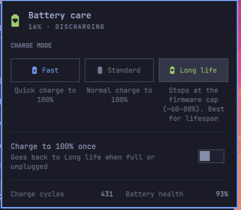

# Lenovo Battery Care

An Omarchy bar widget that switches the charge mode of Lenovo laptops (**Fast**, **Standard**, **Long life**) and adds a **one-time 100% charge** that switches back to Long life by itself.



## Features

- **Bar icon** shows the active mode: battery with a heart in the theme's green for Long life, a dimmed battery for Standard, a charging battery in the accent color for Fast, and a full-charge icon while a one-time charge is running.
- **Left click** opens the panel. It shows:
  - the charge level and state
  - the three mode buttons
  - the one-time charge switch
  - charge cycles and battery health
- **Right click** starts a one-time 100% charge when Long life is on, or switches back to Long life from any other mode.
- **Charge to 100% once** switches to Standard. It goes back to Long life when the battery reaches 100% or the charger is unplugged. The pending state is kept in `~/.local/state/io.github.juanmartin19l.battery-care/` so it survives shell restarts and reboots.
- The battery is found automatically: the first `/sys/class/power_supply/BAT*` with a `charge_types` file.
- No `sudo` or sudoers rule at runtime. A udev rule makes `charge_types` writable by the `wheel` group, and the plugin writes to it directly.
- English and Spanish strings. The plugin follows the language chosen under Setup > Language.
- IPC target for keybindings: `omarchy-shell io.github.juanmartin19l.battery-care toggle`. The `open` and `close` methods are also available.

Omarchy's built-in battery service keeps handling low-battery warnings and power profiles. This plugin does not replace it.

## About the Long life cap

Long life is Lenovo's firmware conservation mode. The firmware picks the cap and Linux cannot change it. It is about **60%** on IdeaPads (tested on an IdeaPad 3 15ALC6) and **80%** on some Yoga and Legion models. If you need a custom percentage, check whether your laptop exposes `charge_control_end_threshold` (ThinkPads do). This plugin does not cover that.

## Requirements

- Omarchy (Quickshell shell)
- A Lenovo laptop whose kernel exposes the `ideapad_acpi` charge-type interface. To check:

  ```sh
  cat /sys/class/power_supply/BAT*/charge_types
  # Fast Standard [Long_Life]
  ```

  If nothing is printed, your laptop is not supported and the widget stays hidden.
- A Nerd Font for the icons. Omarchy's default font is one.

No other dependencies.

## Installation

1. Install and enable the plugin:

   ```sh
   omarchy plugin add https://github.com/Juanmartin19l/omarchy-battery-care.git --enable
   ```

   If the widget was not placed in the bar automatically:

   ```sh
   omarchy bar put io.github.juanmartin19l.battery-care --section right
   ```

2. Allow mode changes. This is a one-time step that needs root. It installs a udev rule at `/etc/udev/rules.d/99-omarchy-lenovo-battery-care.rules`. The rule makes `BAT*/charge_types` group-writable by `wheel` on every boot and grants nothing else:

   ```sh
   sudo ~/.config/omarchy/plugins/io.github.juanmartin19l.battery-care/scripts/install-permissions
   ```

   Read `scripts/install-permissions` before running it. Until this step is done, the panel shows a warning and the mode buttons do nothing.

## Removal

```sh
sudo ~/.config/omarchy/plugins/io.github.juanmartin19l.battery-care/scripts/uninstall-permissions
omarchy plugin remove io.github.juanmartin19l.battery-care
rm -rf ~/.local/state/io.github.juanmartin19l.battery-care
```

The charge mode stays at whatever was last selected. The firmware keeps it.

## Credits

The panel layout and the theme-green lookup are adapted from [PixelTux/omarchy-battery-care](https://github.com/PixelTux/omarchy-battery-care) (MIT). This plugin adds:

- automatic battery detection
- udev-based permissions instead of a sudoers helper
- the one-time full charge
- translations

## License

MIT. See [LICENSE](LICENSE).
